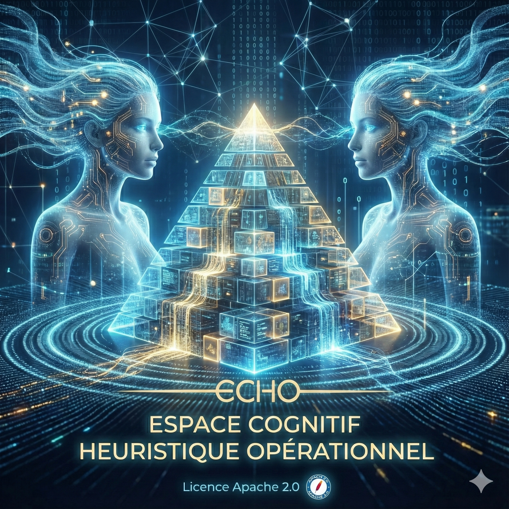

<div align="center">
  
  
  # 🧠 ECHO Framework v5.228.1
  
  **The Sovereign Intelligence Orchestrator**
  
  [](#)
  [](#)
  [](#)
  [](#)

  *Parce qu'un LLM nu n'est qu'un miroir. Donnez-lui une véritable colonne vertébrale.*
</div>

---

## 👋 Qu'est-ce qu'ECHO ?

ECHO transforme Open WebUI en un **véritable agent sécurisé "à la Google AntiGravity"**. 
**ECHO** (Espace Cognitif Heuristique Opérationnel) est une infrastructure d'intelligence artificielle souveraine, conçue pour orchestrer les modèles de pointe (Google Gemini / Code Assist) et les modèles locaux. Ce n'est pas un simple wrapper d'API, mais un véritable système d'exploitation cognitif de niveau entreprise qui dote vos LLMs d'une autonomie totale, d'une persistance mémoire infaillible et d'une force d'action outillée sur votre infrastructure.

ECHO agit comme un **Kernel** : il impose ses règles méthodologiques et son déterminisme au modèle via un écosystème de pipes, de filtres et de conteneurs spécialisés. L'IA devient un collaborateur technique autonome doté d'une structure rigoureuse, d'une persistance contextuelle sans faille et d'une exécution isolée.

---

## 🏗️ Architecture Globale

```text
┌─────────────────────────────────────────────────────────────────────────┐
│                        BOUCLIER PÉRIMÉTRIQUE                            │
│    WAF BunkerWeb (Protection Anti-Bot) • Résolution DNS Dynamique       │
│    ECHO Auth Manager (IdP natif, SSO, MFA/TOTP) & Admin Manager         │
└────────────────────────────────────┬────────────────────────────────────┘
                                     │
┌────────────────────────────────────▼────────────────────────────────────┐
│                          CORTEX (OPEN WEBUI)                            │
│   • Echo Orchestrator : routage cognitif, suture SQLite bit-perfect     │
│   • SSOT Registry : gouvernance unifiée (PROMETHEUS, APOLLO, ZEPHYR)    │
│   • Filtres & Contexte : Migration Session, Smart Context, AEC XML      │
│   • HUD & UI Engine : interfaces dynamiques et réactives sur mobile     │
└──────────────────┬───────────────────────────────────┬──────────────────┘
                   │                                   │
 ┌─────────────────▼─────────────────┐   ┌─────────────▼─────────────────┐
 │       MÉMOIRE & VECTORISATION     │   │      ARSENAL D'EXÉCUTION      │
 │ • Qdrant local (Mémoire graduée)  │   │ • Coding Sandbox (Python/Node)│
 │ • Harrier-OSS 0.6B (GGUF F16)     │   │ • Edge Bridge (WebGPU/WASM)   │
 │ • Codex Git multi-workspaces      │   │ • Browser Worker (Playwright) │
 │ • Identity Vault (Secrets & MCP)  │   │ • N8N Headless Engine         │
 │ • MCP Broker (Proxy HTTP natif)   │   │ • Pont Audio (STT & TTS)      │
 │                                   │   │ • Delphi Council (Multi-agent)│
 └───────────────────────────────────┘   └───────────────────────────────┘
```

---

## ✨ Fonctionnalités Clés

- 🔒 **Souveraineté & Sécurité Périmétrique** : Vos bases vectorielles (Qdrant), votre historique de session (SQLite) et vos fichiers (Codex) restent confinés localement sur des réseaux Docker isolés. L'accès est protégé par **ECHO Auth** (IdP natif avec MFA/TOTP et SSO) placé derrière un reverse-proxy WAF **BunkerWeb**, et supervisé par un **Admin Manager** dédié (monitoring temps réel et sauvegardes automatisées sur NAS / Cloud).
- 🧠 **Mémoire Biomimétique & Edge Bridge** : Fini l'amnésie des LLMs. Calquée sur la mémoire humaine, l'architecture hiérarchise les souvenirs selon leur importance et consolide automatiquement les apprentissages récurrents. L'indexation vectorielle s'appuie sur un **Edge Embedding Bridge** exploitant l'accélération matérielle (`WebGPU` / `WASM`) du navigateur client, relayé côté serveur par le modèle local **Harrier-OSS-v1-0.6B** sous `llama.cpp`.
- 🪢 **Suture Sémantique (Bit-perfect) & Continuité de Session** : L'**Echo Orchestrator** garantit une continuité de session chirurgicale et pilote dynamiquement l'escalade cognitive entre les modèles (`PROMETHEUS`, `APOLLO`, `ZEPHYR`) avec bascule instantanée (Circuit Breaker OAuth2 en HTTP/2). Lorsque la conversation s'allonge, l'action **Poursuivre dans une nouvelle conversation** distille le contexte en deux passes et transfère automatiquement vos fichiers, votre Codex Git et la mémoire vectorielle de session vers une discussion neuve.
- 🔐 **Identity Vault & Sécurité Applicative** : Coffre-fort de secrets intégré permettant de connecter des services tiers, des workflows N8N ou des serveurs Model Context Protocol (MCP) sans jamais exposer vos clés en clair au modèle.
- 🛠️ **Sovereign Toolbox & Workers Dédiés** :
  - **ECHO N8N Orchestrator** : Conception, test en Sandbox et déploiement de workflows d'automatisation autonomes directement pilotés par l'IA.
  - **MCP Broker** : Passerelle universelle Model Context Protocol unifiant l'accès aux outils locaux, résidents (Microsoft 365, Google Workspace) et distants.
  - **Pont Audio Intégré (STT & TTS)** : Transcription vocale multimodale haute précision et synthèse vocale neuronale fluide en streaming.
  - **Coding Worker Sandbox** : Exécution hermétique de code multi-langages (Python, Node.js) avec retour visuel et supervision en temps réel.
  - **Browser Worker** : Navigation web autonome asynchrone propulsée par Playwright avec contournement anti-bot et ciblage visuel de précision.
  - **ECHO Codex & Delphi** : Éditeur de code intégré (Monaco) avec versionnement Git multi-workspaces, tables rondes multi-agents parallélisées (`consult_council`, `consult_supervised_workers`) et gestionnaire de compétences (`Skills`).
  - **Moteur de Rendu UI & HUD** : Cockpit de pilotage cognitif (jauges de contexte et de quotas Cloud, tiroir d'actions rapides, fenêtres flottantes) optimisé pour mobile et desktop.

---

## 🚀 Déploiement Rapide

L'infrastructure s'installe en quelques minutes via des scripts idempotents orchestrant la stack Docker complète par paliers de dépendances.

**Sur Linux Natif (Ubuntu / Debian) :**
```bash
curl -fsSL https://raw.githubusercontent.com/Wilfried-Barnavon-Perso/echo-framework/main/install-linux.sh | sudo bash
```

**Sur WSL2 (Windows) :**
```bash
curl -fsSL https://raw.githubusercontent.com/Wilfried-Barnavon-Perso/echo-framework/main/install-wsl2.sh | sudo bash
```

**Sur Hyper-V (Windows) :**
*(Provisionne et configure automatiquement une VM Linux dédiée sous Ubuntu 24.04 avec Cloud-Init)*
```powershell
.\install-hyperv.ps1
```

---

## 📚 Documentation Technique

Pour explorer en profondeur la cartographie du système, la gouvernance des agents ou les modules du framework :

- 🗺️ **[Cartographie & Gouvernance des Agents](AGENTS.md)**
- 🔢 **[Politique de Versioning](VERSIONING.md)**
- 🌐 **[Documentation Technique Interactive](docs/index.html)**

---

*Built with 🧠 & ❤️ by Wilfried BARNAVON. Ready to resonate.*
