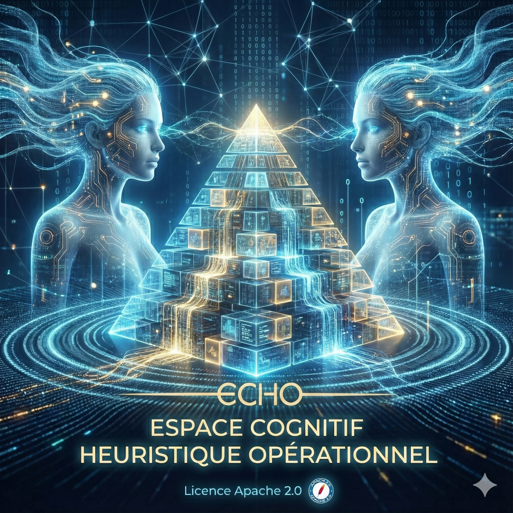

<div align="center">
  
  
  # 🧠 ECHO Framework v5.237.19
  
  **The Sovereign Intelligence Orchestrator**
  
  [](#)
  [](#)
  [](#)
  [](#)

  *Parce qu'un LLM nu n'est qu'un miroir. Donnez-lui une véritable colonne vertébrale.*
</div>

---

## 👋 Qu'est-ce qu'ECHO ?

ECHO transforme Open WebUI en un **véritable agent sécurisé "à la Google AntiGravity"**. 
**ECHO** (Espace Cognitif Heuristique Opérationnel) est une infrastructure d'intelligence artificielle souveraine, conçue pour orchestrer les modèles de pointe (Google Gemini / Code Assist) et les modèles locaux. Ce n'est pas un simple wrapper d'API, mais un véritable système d'exploitation cognitif de niveau entreprise qui dote vos LLMs d'une autonomie totale, d'une persistance mémoire infaillible et d'une force d'action outillée sur votre infrastructure.

ECHO agit comme un **Kernel** : il impose ses règles méthodologiques et son déterminisme au modèle via un écosystème de pipes, de filtres et de conteneurs spécialisés. L'IA devient un collaborateur technique autonome doté d'une structure rigoureuse, d'une persistance contextuelle sans faille et d'une exécution isolée.

---

## 🏗️ Architecture Globale

```text
┌─────────────────────────────────────────────────────────────────────────┐
│                        BOUCLIER PÉRIMÉTRIQUE                            │
│    WAF BunkerWeb (Protection Anti-Bot) • Résolution DNS Dynamique       │
│    ECHO Auth (SSO & MFA) • Admin Manager • User Manager (my.DOMAINE)    │
└────────────────────────────────────┬────────────────────────────────────┘
                                     │
┌────────────────────────────────────▼────────────────────────────────────┐
│                          CORTEX (OPEN WEBUI)                            │
│   • Echo Orchestrator : routage cognitif, suture SQLite bit-perfect     │
│   • SSOT Registry : gouvernance unifiée (PROMETHEUS, APOLLO, ZEPHYR)    │
│   • Filtres & Contexte : Migration/Fork Session, Smart Context, AEC XML │
│   • Window Manager & HUD : fenêtres multi-chats, jauge quotas, Codex UI │
└──────────────────┬───────────────────────────────────┬──────────────────┘
                   │                                   │
 ┌─────────────────▼─────────────────┐   ┌─────────────▼─────────────────┐
 │       MÉMOIRE & VECTORISATION     │   │      ARSENAL D'EXÉCUTION      │
 │ • Qdrant local (Mémoire graduée)  │   │ • Coding Sandbox (Python/Node)│
 │ • Harrier-OSS 0.6B (GGUF F16)     │   │ • Edge Bridge (WebGPU/WASM)   │
 │ • Codex Git multi-workspaces      │   │ • Browser Worker (Playwright) │
 │ • Identity Vault (Secrets & MCP)  │   │ • N8N Headless Engine         │
 │ • MCP Broker (Proxy HTTP natif)   │   │ • Pont Audio (STT & TTS)      │
 │                                   │   │ • Delphi Council (Multi-agent)│
 └───────────────────────────────────┘   └───────────────────────────────┘
```

---

## ✨ Fonctionnalités Clés

- 🔒 **Souveraineté & Sécurité Périmétrique** : Vos bases vectorielles (Qdrant), votre historique de session (SQLite) et vos fichiers (Codex) restent confinés localement sur des réseaux Docker isolés. L'accès est protégé par **ECHO Auth** (IdP natif avec MFA/TOTP, SSO et gestion de sessions Dual-Tier adaptative selon le niveau de confiance de l'appareil) placé derrière un reverse-proxy WAF **BunkerWeb**, supervisé par un **Admin Manager** dédié (monitoring temps réel, élagage SSoT par propriétaire et sauvegardes automatisées sur NAS / Cloud), et complété par le **User Manager** (`my.DOMAINE`, portail self-service de suivi d'empreinte, révocation des sessions SSO, export intégral `.tar.xz` auto-détruit après téléchargement et suppression autonome du compte sous contrôle MFA).
- 🧠 **Mémoire Biomimétique & Edge Bridge** : Fini l'amnésie des LLMs. Calquée sur la mémoire humaine, l'architecture hiérarchise les souvenirs selon leur importance et consolide automatiquement les apprentissages récurrents. L'indexation vectorielle s'appuie sur un **Edge Embedding Bridge** exploitant l'accélération matérielle (`WebGPU` / `WASM` en `fp16`, validée en amont par une sonde matérielle et un smoke test de calcul avant tout téléchargement) du navigateur client, relayé côté serveur par le modèle local **Harrier-OSS-v1-0.6B** sous `llama.cpp`.
- 🪢 **Suture Sémantique (Bit-perfect), Compaction In-Place & Continuité de Session** : L'**Echo Orchestrator** garantit une continuité de session chirurgicale et pilote dynamiquement l'escalade cognitive entre les modèles (`PROMETHEUS`, `APOLLO`, `ZEPHYR`) avec bascule instantanée (Circuit Breaker OAuth2 en HTTP/2). Lorsque la conversation s'allonge, que vous supprimez un tour intermédiaire ou que vous explorez une piste alternative, la **Compaction Contextuelle Automatique In-Place**, l'**Élagage Transactionnel des Branches Mortes** (préservant vos fichiers produits), l'action **Poursuivre dans une nouvelle conversation** (distillation en deux passes et conservation des étiquettes) ainsi que le support natif du **Clonage et de la Bifurcation (Fork)** condensent ou transfèrent automatiquement vos échanges, vos fichiers, votre Codex Git multi-espaces et la mémoire vectorielle de session.
- 🔐 **Identity Vault & Chiffrement Authentifié (`AES-256-GCM`)** : Coffre-fort de secrets chiffré au repos avec dérivation cryptographique par utilisateur (`HKDF-SHA256`) et liaison contextuelle anti-substitution (`AAD`), permettant de connecter des services tiers, des workflows N8N ou des serveurs Model Context Protocol (MCP) multi-comptes sans jamais exposer vos clés en clair au modèle ni dans les journaux d'exécution.
- 🛠️ **Sovereign Toolbox & Workers Dédiés** :
  - **ECHO N8N Orchestrator** : Conception, test en Sandbox isolée et déploiement de workflows d'automatisation autonomes directement pilotés par l'IA, avec injection à la volée et masquage automatique des secrets.
  - **MCP Broker** : Passerelle universelle Model Context Protocol multi-comptes unifiant l'accès aux outils locaux, résidents (Microsoft 365, Google Workspace, France Travail, Sirene) et distants avec isolation stricte par utilisateur.
  - **Pont Audio Intégré (STT & TTS)** : Transcription vocale multimodale haute précision et synthèse vocale neuronale fluide en streaming.
  - **Coding Worker Sandbox & Fenêtrage Réactif** : Exécution hermétique de code multi-langages (Python, Node.js) sous Bubblewrap en mode synchrone ou détaché en arrière-plan (`control_sandbox_execution`), avec projection directe d'interfaces web interactives (`echo_monitor`), canal RPC bidirectionnel temps réel UI <-> Sandbox (`postMessage` / UCTP) sans rechargement DOM, et supervision de cycle de vie anti-zombie.
  - **Browser Worker** : Navigation web autonome asynchrone propulsée par Playwright avec architecture Zéro-Trace DOM, curseur incrusté hors-DOM, contournement anti-bot et ciblage visuel de précision.
  - **Studio Visuel, Imagerie Supervisée, ECHO Codex & Delphi** : Génération de visualisations interactives 2D/3D auto-vérifiées en mémoire vive, studio de création, fusion multi-images et retouche itérative d'images supervisées (`generate_image`), éditeur de code intégré (Monaco) multi-workspaces (`main`, `plans`, `generated`, `sandbox`) doublé d'un **Éditeur Hexadécimal virtualisé**, prévisualisation multimédia en direct (Markdown, HTML, SVG, PDF, images avec zoom tactile mobile, copie et export instantanés), consultation inter-conversations en lecture seule, **liens Codex cliquables** directement dans les réponses de l'IA, tables rondes multi-agents parallélisées (`consult_council` avec contradiction intra-spécialité, `consult_supervised_workers`) et gestionnaire de compétences (`Skills`).
  - **Window Manager (`EchoWM`), HUD & Conseiller d'Outils** : Gestionnaire de fenêtres multi-chats et multi-navigateurs avec isolation stricte par propriétaire, parquant et restaurant vos outils sans perte d'état lors des changements de discussion, **Jauge Contextuelle & Quotas Cloud (5h / Semaine)** avec suivi différentiel dès le premier tour et compteur de compaction, et **Expert-Conseil Opérationnel (`tool_advisor`)** adossé à 10 manuels spécialisés réduisant de 80 % l'empreinte des 98 outils.

---

## 🚀 Déploiement Rapide

L'infrastructure s'installe en quelques minutes via des scripts idempotents orchestrant la stack Docker complète par paliers de dépendances.

**Sur Linux Natif (Ubuntu / Debian) :**
```bash
curl -fsSL https://raw.githubusercontent.com/Wilfried-Barnavon-Perso/echo-framework/main/install-linux.sh | sudo bash
```

**Sur WSL2 (Windows) :**
```bash
curl -fsSL https://raw.githubusercontent.com/Wilfried-Barnavon-Perso/echo-framework/main/install-wsl2.sh | sudo bash
```

**Sur Hyper-V (Windows) :**
*(Provisionne et configure automatiquement une VM Linux dédiée sous Ubuntu 26.04 avec Cloud-Init)*
```powershell
.\install-hyperv.ps1
```

---

## 📚 Documentation Technique

Pour explorer en profondeur la cartographie du système, la gouvernance des agents ou les modules du framework :

- 🗺️ **[Cartographie & Gouvernance des Agents](AGENTS.md)**
- 🔢 **[Politique de Versioning](VERSIONING.md)**
- 🌐 **[Documentation Technique Interactive](docs/index.html)**

---

*Built with 🧠 & ❤️ by Wilfried BARNAVON. Ready to resonate.*
